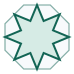

# zola-theme-arabesque

A theme for the static site generator [Zola](https://www.getzola.org), based on the
[Arabesque design system](https://github.com/ArabesqueLabs/design-system):
calm, accessible (WCAG 2.2 AA as a floor), and bidirectional, in English and
Arabic, light and dark, from the start.

<p>
  
  
</p>

- **A range of templates for your site:** a home page with a hero on the drawn pattern; sections that list their pages (dated, as articles; otherwise, as a list), paginated; pages with "On this page", breadcrumbs, terms and the pages either side; tags; an archive by year; search; and a page for when something isn't found.
- **Bidirectional:** each language has its own address and the header links each page to its translation. Right-to-left languages mirror, with logical properties only; numbers, code and the pattern don't.
- **Light and dark:** follows the reader's system, with a button that cycles through system, light and dark, each with its own icon; the choice is remembered, with no flash.
- **The design system's own components:** the site header, footer, breadcrumbs, pagination, "On this page", code blocks with a copy button, tables, notices, disclosures and more, written as their specs say. Markdown's code blocks and tables become them.
- **Nineteen shortcodes:** the design system's components Markdown can't write, and galleries, separators, Mermaid diagrams, and YouTube, PDF, Gist and Instagram embeds.
- **Nothing from elsewhere, unless you embed it:** the fonts, CSS and scripts are in the theme. No tracking, no framework. The script only adds to pages that already work without it. Embeds (a video, a gist, a Mermaid diagram) load from their own sites, only on the pages that have them.

## Install

Zola 0.19 or later. In your site:

```sh
git submodule add https://github.com/ArabesqueLabs/zola-theme-arabesque.git themes/arabesque
```

Then in `config.toml`:

```toml
theme = "arabesque"

[markdown]
highlight_code = true
highlight_theme = "css"   # code in the design system's syntax colours
```

To see every template working, in English and Arabic, clone this repository and run `zola serve` in it: like the other themes in Zola's gallery, the repository is itself the demo site.

```sh
git clone https://github.com/ArabesqueLabs/zola-theme-arabesque.git
cd zola-theme-arabesque && zola serve
```

## Configure

The defaults are in [`theme.toml`](theme.toml). To change one, set the same key under `[extra]` in your `config.toml`. Tables merge key by key, so you only write what differs; a list replaces the theme's whole. The demo's [`config.toml`](config.toml) sets every key, so it doubles as a full example.

### Header and footer

```toml
[extra.header]
logo = ""              # an image in static/, shown before the site's title
sticky = true          # keep the header at the top as the page scrolls
theme_toggle = true
language_link = true

# The menu, per language. url is content ("@/…md", in this language), a path, or an address.
[[extra.menu.en]]
name = "Blog"
url = "@/blog/_index.md"

# One action that stays in the bar at every width (optional).
[extra.header.action.en]
name = "Subscribe"
url = "@/subscribe.md"

[[extra.footer.links.en]]
name = "Privacy"
url = "@/privacy.md"

[[extra.footer.links.en]]
name = "Source on GitHub"   # with an icon, the link is the icon, named by this
url = "https://github.com/me/site"
icon = "github"

[extra.footer.text]
en = "Written in London."   # a line under the copyright

[extra.footer.copyright]     # in place of the theme's "© %year %name."; HTML is kept
en = 'Made with ♥ by <a href="https://example.com">Me</a> | © %year'

[extra.footer]
lockup = false     # the site's name (and logo) in the footer too
credit = false     # "Built with Zola and the Arabesque design system."
feed_link = true   # an icon linking the Atom feed, after the links (when generate_feeds is on)
```

### Home page

The hero comes from `content/_index.md`'s front matter; its content follows the hero; then the latest pages of one section.

```toml
+++
title = "My site"

[extra.hero]
eyebrow = "Optional words above the title"
title = "One sentence that says what this is."
lede = "One or two more."               # the section's description by default
caption = "What the teal tile is."     # under the pattern's focal tile (optional)
actions = [
  { name = "Start here", url = "@/docs/_index.md" },      # the primary button
  { name = "Read the blog", url = "@/blog/_index.md" },   # text links after it
]
links = [                                                 # icon links under them
  { name = "GitHub", url = "https://github.com/me/site", icon = "github" },
  { name = "Atom feed", icon = "feed" },                  # the feed in this language
]
+++
```

A logo or a profile picture takes the place of the pattern's teal focal tile (on a phone, it sits above the title):

```toml
[extra.hero]
image = "logo.svg"           # in static/, or an address; photos are resized by Zola
image_alt = ""               # empty for a logo the title already names; a description for a photo
image_style = "logo"         # "logo" (as it is, the default) or "portrait" (cropped to a circle)
# initials = "LH"            # with no image: initials in a circle, as a placeholder
                             # (a portrait with neither shows an anonymous profile picture)
# tint = "teal"              # the placeholder's colours: teal, blue, green, yellow, orange,
                             # pink, purple or cyan; neutral greys without one
```

A portrait sits in a halo: a ring of the page's background with a hairline, which clears the pattern around it (the design system has no drop shadows). The placeholder is drawn in the page, in the theme's colours, so it follows the theme button. To change any of it, set these in your own stylesheet (`extra.stylesheets`):

```css
.zt-hero {
  --zt-hero-halo: 0.875rem;                          /* the ring's width; 0 for none */
  --zt-avatar-ground: var(--al-color-surface-sunk);  /* the placeholder's circle */
  --zt-avatar-figure: var(--al-color-line-strong);   /* the placeholder's figure */
}
```

```toml
[extra.home]
section = "blog/_index.md"   # "" (the default) for none
count = 5
pattern = true               # the drawn pattern behind the hero
animate = true               # it draws itself in once (never under reduced motion)
```

### Pages

| Key | Default | Does |
|---|---|---|
| `extra.page.toc_min_headings` | `4` | "On this page" for a page with this many `h2`s; `0` for never |
| `extra.page.reading_time` | `true` | Minutes to read, beside the date |
| `extra.page.page_nav` | `true` | The pages either side: Newer and Older by date, Previous and Next otherwise |
| `extra.page.back_to_top_after` | `0.5` | Show "Back to top" once the page has scrolled this many screens |

In a page's front matter, under `[extra]`: `toc = true | false` overrides the contents, and `image = "cover.png"` (beside the page, in static/, or an address) is its social image, with `image_alt` for its alt text. `draft = true` adds a Draft badge; `authors = [...]` names who wrote it.

### Sharing and search

Each page describes itself to the sites and apps that preview links (Open Graph, for Facebook, LinkedIn, Slack, Discord, Mastodon and most others; X's cards) and to search engines (schema.org JSON-LD: the site on the home page, a `BlogPosting` for each dated page, a `WebPage` or `CollectionPage` for the rest). With nothing set, the tags use each page's title, description, date, tags, authors and image, then the site's.

```toml
[extra.social]
image = "social.png"                     # for pages without their own; best at 1200×630
image_alt = "The site's name on the pattern"
twitter_site = "@site"
twitter_creator = "@you"
fediverse_creator = "@you@example.social"
publisher_type = "Person"                # or "Organization"
same_as = ["https://github.com/you"]
```

| Key | Default | Does |
|---|---|---|
| `extra.social.enabled` | `true` | All of the tags; `false` for none |
| `extra.social.image` | `""` | The image shared with a page that has none of its own: in static/, or an address |
| `extra.social.image_alt` | `""` | What that image shows |
| `extra.social.twitter_site` | `""` | The site's X account, `"@name"` |
| `extra.social.twitter_creator` | `""` | The author's X account |
| `extra.social.fediverse_creator` | `""` | The author's fediverse account, `"@name@example.social"`: Mastodon credits it on shared links |
| `extra.social.schema_org` | `true` | The schema.org data |
| `extra.social.publisher_type` | `"Person"` | Who publishes the site: `"Person"` or `"Organization"`, named by `extra.author`, then `author`, then the title |
| `extra.social.same_as` | `[]` | Your profiles elsewhere, for schema.org's `sameAs` |

### Everything else

| Key | Does |
|---|---|
| `extra.search.page` | The search page (`"@/search.md"`); adds a search button to the header |
| `extra.favicon` | Your icon, in static/; the pattern's star by default |
| `extra.author` | Who the copyright line names; `author`, then `title`, by default |
| `extra.stylesheets` | Your own CSS files, in static/, loaded after the theme's |
| `extra.rtl_languages` | Languages written right to left |
| `extra.language_names` | Each language, named in itself (`ar = "العربية"`): the language link's name |
| `extra.language_glyphs` | Each language's letter, shown in a key as the language link (`ar = "ع"`, `en = "En"`); the translate icon for a language without one |
| `extra.i18n.<lang>` | The words the theme writes, per language |

## Templates

Zola's own: `index.html`, `section.html`, `page.html`, `taxonomy_list.html`, `taxonomy_single.html` and `404.html`. Two for a section of projects:

- **`projects.html`** and **`project.html`**: a section's pages as cards, each with its picture (or its first letter on the quiet pattern), summary, year, and links to its site and source; then each subsection's, under its title. On a project's own page, the year and links sit under its title, with the picture below them.

  ```toml
  +++
  title = "Projects"
  sort_by = "weight"
  template = "projects.html"
  page_template = "project.html"
  +++
  ```

  and in each project's front matter, all optional:

  ```toml
  [extra]
  image = "cover.jpg"   # beside the page (a page bundle), in static/ ("/img/x.png"), or an address
  image_alt = ""        # on the project's own page; the card's picture is decoration
  year = "2024"
  website = "https://example.com"
  source = "https://github.com/me/project"   # a GitHub address gets GitHub's mark
  ```

And two for a page's `template`:

- **`archive.html`**: every page of a section by year. `[extra] section = "blog/_index.md"`; the home page's section by default.
- **`search.html`**: search in the browser over Zola's index, as people type, with the query in the address (`?q=`). Arabic is matched without its vowel marks, and with its letter variants folded. For each language:

  ```toml
  build_search_index = true

  [search]
  index_format = "fuse_json"   # indexes Arabic as well as English; elasticlunr can't

  [extra.search]
  page = "@/search.md"
  ```

  and `content/search.md` (and `search.ar.md` …) with `template = "search.html"`.

To change a template, copy it to your site's `templates/` with the same name; or extend the theme's and replace a block (`title`, `head`, `top`, `main`, `scripts`):

```jinja

<script src="/my.js" defer></script>
```

## Shortcodes

| Shortcode | Writes |
|---|---|
| `Markdown` | A notice: `info` (default), `success`, `warning`, `danger` (errors only) |
| `Markdown` | A disclosure, with a value shown while closed |
| `Their words` | A quote, with who said it |
| `` *a fenced block* `` | A code block with its file's name in the bar |
| `{{ command(text="zola serve") }}` | One line to paste into a terminal, with a copy button |
| `{{ stats(labels=[…], values=[…], notes=[…]) }}` | Two to four figures, side by side |
| `{{ steps(titles=[…], bodies=[…]) }}` | Numbered stages |
| `{{ cta(title, lede, url, text, url2, text2) }}` | A call to action on the quiet pattern |
| `{{ button(url, text, style="primary") }}` | A link as a button: `primary`, `default`, or `arrow` (a text link) |
| `{{ badge(text, kind) }}` | A status in a word: `neutral`, `accent`, `success`, `warning`, `danger`, `info`, `outline` |
| `{{ kbd(keys="Ctrl+K") }}` | Keys to press |
| `{{ figure(src, alt, caption, width, height) }}` | An image with its caption |
| `{{ gallery(alts=[…], columns=16) }}` | The images beside a page (a page bundle), as thumbnails Zola makes |
| `{{ separator(style="star", gap="lg") }}` | A break between scenes: 15 styles (`asterisks`, `dots`, `arabic`, `star`, `rule`, `gradient`…), with `gap`, `size`, `width`, `color` |
| `flowchart LR…` | A Mermaid diagram in the theme's colours, redrawn when the theme changes (Mermaid loads from jsDelivr, on that page only) |
| `{{ youtube(id, playlist, start, title) }}` | A YouTube video or playlist, 16:9, from the no-cookie domain |
| `{{ pdf(src, title, height) }}` | A PDF in the page, with a link to download it |
| `{{ gist(user, gist, file) }}` | A GitHub Gist (GitHub's script), with a link without JavaScript |
| `{{ instagram(id) }}` | An Instagram post (Instagram's script), a link until it loads |

The demo's [Shortcodes](content/docs/shortcodes.md) page shows each one, and [Galleries, diagrams and embeds](content/blog/components/index.md) the last seven working.

## Languages

```toml
default_language = "en"

[languages.ar]
title = "موقعي"
```

Write each page's translation beside it (`about.md`, `about.ar.md`). A language in `extra.rtl_languages` is set right to left. The theme's words are in English and Arabic; for another language, add `[extra.i18n.<code>]` with every key in the theme's `[extra.i18n.en]`, including `date_format` and `date_locale`. A language without one uses the English words.

## Inside

```
templates/              the templates, partials/ and shortcodes/
static/arabesque/       the design system, copied unchanged: arabesque.css, icons.svg, fonts/, js/ (VERSION says which)
static/arabesque/theme/ the theme's own: theme.css (layout, Markdown, syntax colour), theme.js, search.js, favicon.svg
config.toml, content/   the demo site (used only when you serve this repository itself)
scripts/vendor-arabesque.sh   copies a released design system version into static/arabesque/
```

`theme.css` follows the design system's rules: tokens only, logical properties only. Its classes start `zt-`; the system's, `al-`. It's unlayered, so it wins over the system's layers, and your own `extra.stylesheets` win over both.

To move to a newer design system: `scripts/vendor-arabesque.sh 0.10.0`, then read its [changelog](https://github.com/ArabesqueLabs/design-system/blob/main/CHANGELOG.md): before 1.0, a minor version may rename or remove classes.

## Licence

The theme is [MIT licensed](LICENSE), as is the design system's code in
`static/arabesque/` ([its licence](static/arabesque/LICENSE)). The fonts keep
their own licences, the SIL Open Font License 1.1, whose texts are beside them
in `static/arabesque/fonts/`. 
