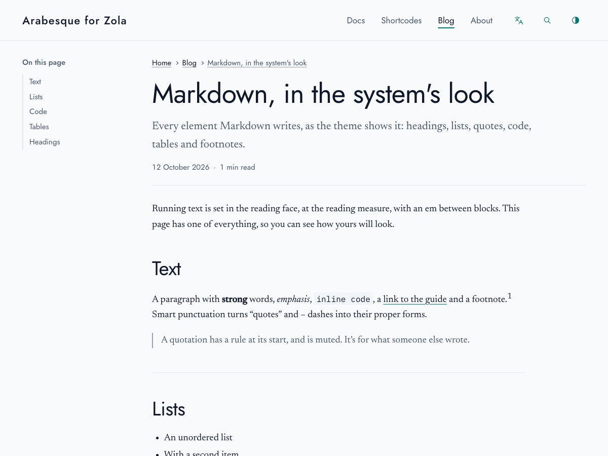

+++
title = "Markdown، بمظهر النظام"
description = "كل عنصر تكتبه Markdown كما يعرضه القالب: العناوين، والقوائم، والاقتباسات، والشيفرة، والجداول، والصور، والحواشي."
date = 2026-10-12
[taxonomies]
tags = ["Markdown", "مرجع"]
+++

يُكتب النص الجاري بخط القراءة، وبعرض القراءة، وبين كتلة وأخرى مسافة سطر. في هذه الصفحة عيّنة من كل عنصر، لترى كيف سيبدو ما تكتبه. مرّر المؤشر فوق أي عنوان لترى رابطه.

## النص

فقرة فيها كلمات **بارزة**، و*مائلة*، و***الاثنان معًا***، و`شيفرة داخل السطر`، و[رابط إلى الدليل](@/docs/_index.ar.md)، و~~كلمة مشطوبة~~، وحاشية.[^1] تحوّل علامات الترقيم الذكية علامات الاقتباس "المزدوجة" و'المفردة'، والشرطات -- و---، والنقاط الثلاث... إلى أشكالها الصحيحة.

يمكن للسطر أن ينكسر دون فقرة جديدة:\
ضع شرطة مائلة عكسية في آخره،  
أو مسافتين.

> للاقتباس خطّ في بدايته، ولونه خافت. هو لما كتبه غيرك.
>
> ويمكن أن يمتدّ إلى أكثر من فقرة.

---

## HTML داخل النص

تمرّر Markdown وسوم HTML كما هي، للأشياء القليلة التي ليس لها صيغة فيها. اضغط <kbd>Ctrl</kbd> + <kbd>K</kbd> للبحث؛ و<mark>ظلّل عبارة</mark> مهمّة؛ واكتب H<sub>2</sub>O وE = mc<sup>2</sup>؛ واشرح تخطيط <abbr title="من اليمين إلى اليسار">RTL</abbr> عند تمرير المؤشر.

## القوائم

- قائمة نقطية
- فيها عنصر ثانٍ
  - وعنصر متداخل داخله
    - وعنصر داخل ذلك
- وعنصر أخير

1. قائمة مرقّمة
2. تعدّ عناصرها
   - مع قائمة نقطية داخل عنصر
   - تحتفظ بعلاماتها
3. بأرقام الصفحة

يمكن للقائمة التي تلي فقرة أن تبدأ من أي رقم:

5. تبدأ هذه من الخمسة
6. وتواصل العدّ من هناك

- [x] مهمة أُنجزت
- [ ] ومهمة لم تُنجز

1. يمكن للعنصر أن يضمّ أكثر من فقرة.

   أزِح الفقرة التالية لتحاذي نص العنصر، فتبقى داخله.

   ```sh
   zola serve
   ```

2. والشيفرة أيضًا، كما في الأعلى.

## الصور

تملأ الصورة القائمة في سطرها عرض القراءة، وتحتفظ بزوايا النظام.



## الشيفرة

تبقى الشيفرة من اليسار إلى اليمين، حتى في صفحة عربية:

```js
// نص القالب البرمجي، باختصار.
import { initToc } from "../js/toc.js";
const strings = JSON.parse(document.getElementById("zt-strings").textContent);
initToc();
```

```rust,linenos,hl_lines=2
fn main() {
    let greeting = "مرحبا";
    println!("{greeting}, world");
}
```

## الجداول

تُصفّ أعمدة الأرقام كأرقام، ويمكن ضبط العمود على البداية أو الوسط أو النهاية بنقطتين رأسيتين في الخط تحت الرأس.

| نقطة التوقف | العرض | الأعمدة |
|:---|:---:|---:|
| صغير | 40rem | 1 |
| متوسط | 52rem | 2 |
| كبير | 64rem | 3 |

يُمرَّر الجدول العريض وحده، ولا تُمرَّر الصفحة أبدًا. (الأرقام مختلَقة.)

| الشهر | المقالات | الكلمات | الدقائق | الصور | الشيفرة | الجداول | الملاحظات | الاقتباسات | القوائم | الروابط | الوسوم | اللغات |
|---|---:|---:|---:|---:|---:|---:|---:|---:|---:|---:|---:|---|
| يناير | 1 | 820 | 4 | 0 | 2 | 0 | 1 | 0 | 1 | 3 | 2 | الإنجليزية |
| فبراير | 2 | 1,460 | 7 | 2 | 3 | 1 | 0 | 1 | 2 | 5 | 4 | الإنجليزية |
| مارس | 2 | 1,910 | 9 | 1 | 5 | 1 | 2 | 0 | 2 | 6 | 3 | كلتاهما |
| أبريل | 3 | 2,730 | 13 | 4 | 6 | 2 | 3 | 1 | 3 | 8 | 6 | كلتاهما |

## العناوين {#headings-in-a-post}

يأتي عنوان الرابط إلى العنوان من كلماته، أو من معرّف تعطيه إياه: هذا هو `#headings-in-a-post`.

### عنوان من المستوى الثالث

#### عنوان من المستوى الرابع

تبدأ العناوين تحت عنوان الصفحة من المستوى الثاني؛ وتسرد «في هذه الصفحة» عناوين المستوى الثاني.

[^1]: تجتمع الحواشي في أسفل الصفحة، بعد خطّ رفيع.
