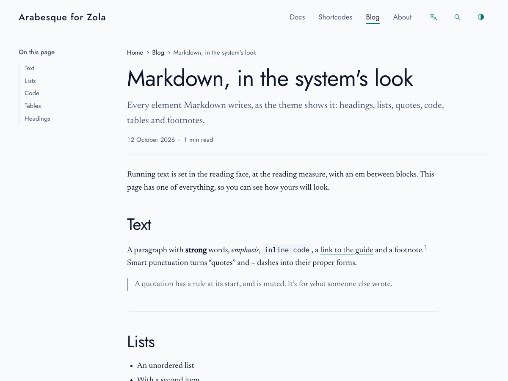

+++
title = "Markdown, in the system's look"
description = "Every element Markdown writes, as the theme shows it: headings, lists, quotes, code, tables, images and footnotes."
date = 2026-10-12
[taxonomies]
tags = ["markdown", "reference"]
+++

Running text is set in the reading face, at the reading measure, with an em between blocks. This page has one of everything, so you can see how yours will look. Hover over a heading for its own link.

## Text

A paragraph with **strong** words, *emphasis*, ***both at once***, `inline code`, a [link to the guide](@/docs/_index.md), ~~a word struck out~~ and a footnote.[^1] Smart punctuation turns "double" and 'single' quotes, -- and --- dashes, and three dots... into their proper forms.

A line can break without a new paragraph:\
put a backslash at its end,  
or two spaces.

> A quotation has a rule at its start, and is muted. It's for what someone else wrote.
>
> It can run to more than one paragraph.

---

## Inline HTML

Markdown passes HTML through, for the few things it has no syntax for. Press <kbd>Ctrl</kbd> + <kbd>K</kbd> to search; <mark>highlight a phrase</mark> that matters; write H<sub>2</sub>O and E = mc<sup>2</sup>; and spell out an <abbr title="Right to left">RTL</abbr> layout on hover.

## Lists

- An unordered list
- With a second item
  - And one nested inside it
    - And one inside that
- And a last one

1. An ordered list
2. Counts its items
   - With a bulleted list inside an item
   - That keeps its own markers
3. In the page's digits

A list after a paragraph can start at any number:

5. This one starts at five
6. And counts on from there

- [x] A task that's done
- [ ] A task that isn't

1. An item can hold more than one paragraph.

   Indent the next one to line up with the item's text, and it stays inside.

   ```sh
   zola serve
   ```

2. Code, too, as above.

## Images

An image on its own line fills the measure, and keeps its corners as the system's.



## Code

```js
// The theme's script, in brief.
import { initToc } from "../js/toc.js";
const strings = JSON.parse(document.getElementById("zt-strings").textContent);
initToc();
```

```rust,linenos,hl_lines=2
fn main() {
    let greeting = "مرحبا";
    println!("{greeting}, world");
}
```

## Tables

Columns of figures are aligned as figures, and a column can be set to the start, the centre or the end with colons in the rule under the head.

| Breakpoint | Width | Columns |
|:---|:---:|---:|
| Small | 40rem | 1 |
| Medium | 52rem | 2 |
| Large | 64rem | 3 |

A wide table scrolls on its own, never the page. (The figures are made up.)

| Month | Posts | Words | Minutes | Images | Code | Tables | Notes | Quotes | Lists | Links | Tags | Languages |
|---|---:|---:|---:|---:|---:|---:|---:|---:|---:|---:|---:|---|
| January | 1 | 820 | 4 | 0 | 2 | 0 | 1 | 0 | 1 | 3 | 2 | English |
| February | 2 | 1,460 | 7 | 2 | 3 | 1 | 0 | 1 | 2 | 5 | 4 | English |
| March | 2 | 1,910 | 9 | 1 | 5 | 1 | 2 | 0 | 2 | 6 | 3 | Both |
| April | 3 | 2,730 | 13 | 4 | 6 | 2 | 3 | 1 | 3 | 8 | 6 | Both |

## Headings {#headings-in-a-post}

A heading's address comes from its words, or from an id you give it: this one is `#headings-in-a-post`.

### A third-level heading

#### A fourth-level heading

Headings below the page's title start at the second level; "On this page" lists the second-level ones.

[^1]: Footnotes gather at the foot of the page, after a hairline.
